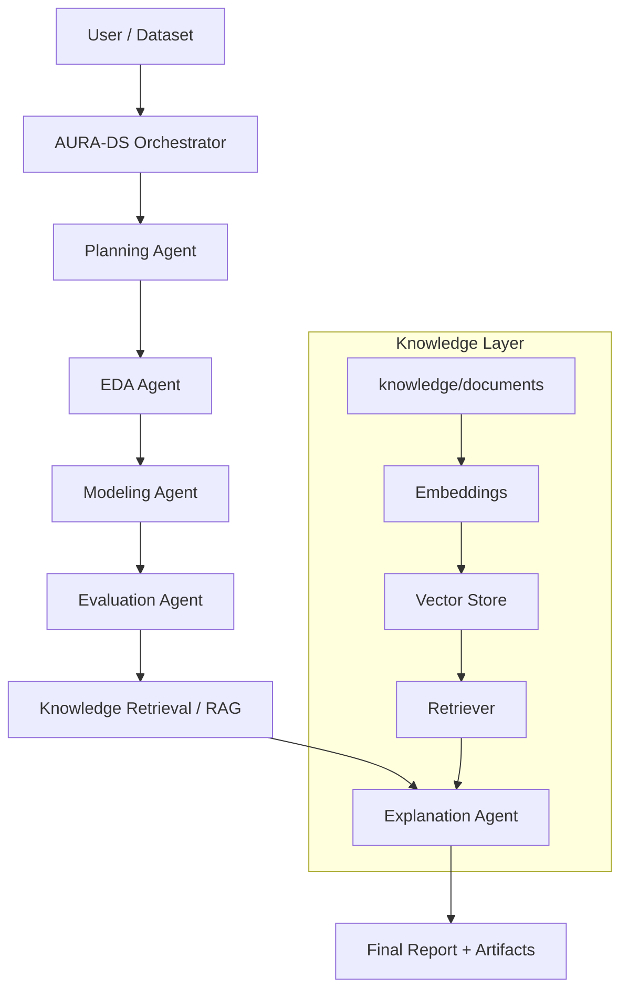
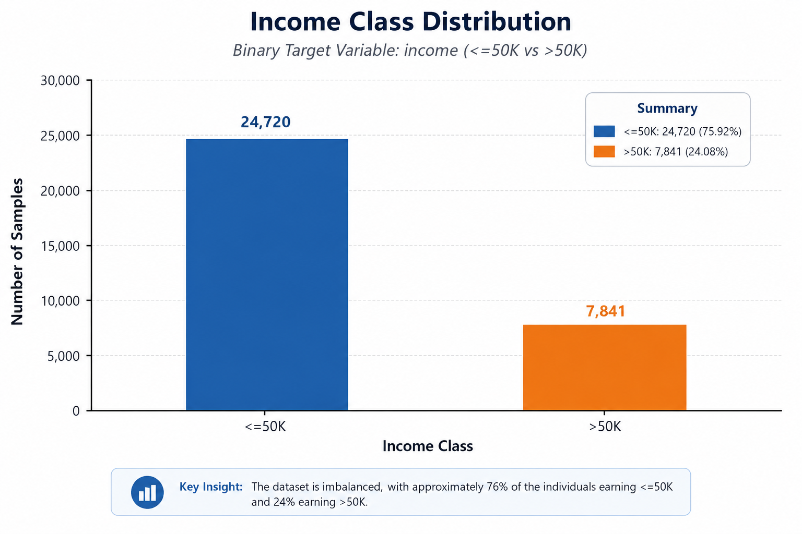
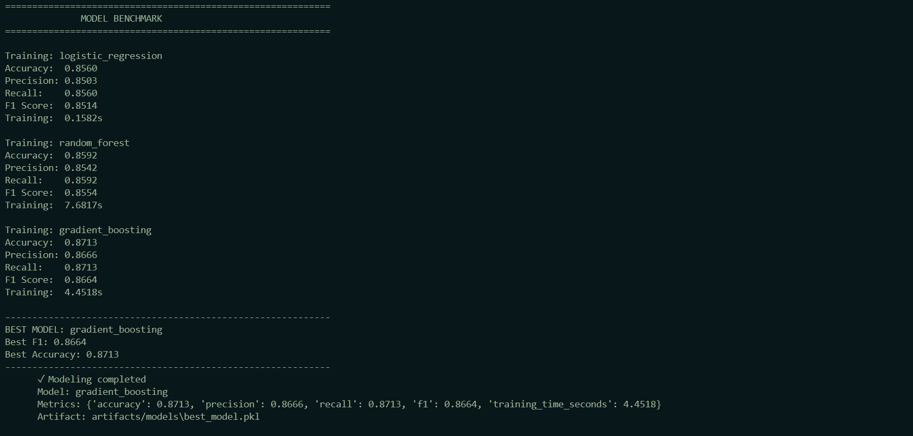
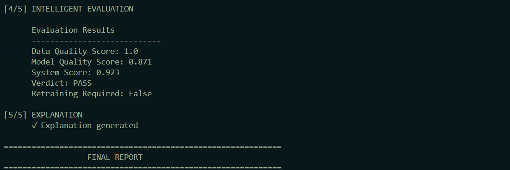
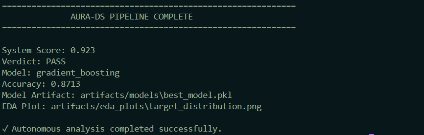

# AURA-DS — Autonomous Unified Reasoning & Analytics Data Science Agent

> An autonomous data science agent that plans, analyzes, models, evaluates, explains, and reports with minimal human intervention.

---

## 1. Overview

AURA-DS is an autonomous data science pipeline that goes beyond a single ML script. Instead of manually chaining together exploratory analysis, model training, evaluation, and reporting, AURA-DS orchestrates the entire workflow through a sequence of specialized agents — each responsible for one stage of the analytical process.

What sets AURA-DS apart from a conventional ML script is that it combines:

- **Autonomous orchestration** — a planning layer that sequences the pipeline stages
- **Machine learning benchmarking** — multiple models trained and compared automatically
- **Intelligent evaluation** — a scoring layer that judges model quality against defined criteria
- **Retrieval-Augmented Generation (RAG)** — a knowledge base that grounds explanations in reference material
- **LLM-based explanation** — Google Gemini (via LangChain) translates raw metrics into human-readable insight

The result is a single command that takes a dataset from raw data to a fully explained, reported outcome.

---

## 2. Problem Statement

Traditional data science workflows require manually coordinating multiple disconnected steps:

**data analysis → model training → model comparison → evaluation → interpretation → reporting**

This creates several recurring pain points:

- Repetitive, boilerplate analysis work for every new dataset
- Fragmented workflows split across notebooks, scripts, and manual review
- Inconsistent or subjective evaluation criteria between projects
- Heavy dependency on a human analyst to interpret model output
- Difficulty reproducing a complete end-to-end analytical workflow

AURA-DS addresses this by unifying the entire process into a single autonomous pipeline — planning, executing, evaluating, and explaining results without step-by-step manual intervention.

---

## 3. What Problem Does It Solve?

| Traditional Workflow | AURA-DS |
|---|---|
| Manual analysis | Automated EDA |
| Manual model comparison | Automated model benchmarking |
| Manual evaluation | Intelligent, criteria-based evaluation |
| Static documentation | Knowledge-backed, RAG-grounded explanation |
| Multiple disconnected steps | Unified autonomous pipeline |

---

## 4. Key Capabilities

- Autonomous planning of the analytical workflow
- Automated exploratory data analysis (EDA)
- Multi-model benchmarking (e.g., Logistic Regression, Random Forest, Gradient Boosting)
- Intelligent evaluation with a composite system score and pass/fail verdict
- Knowledge retrieval via a RAG pipeline over a local document store
- LLM-powered explanation of results using Google Gemini
- End-to-end orchestration from raw dataset to final report
- Artifact generation (plots, benchmark visuals, evaluation summaries)
- Automated final analytical report

---

## 5. Architecture



The orchestrator drives each agent in sequence. The knowledge layer runs in parallel, embedding documents from `knowledge/documents/` so the Explanation Agent can ground its output in retrieved reference material rather than relying purely on model output.

---

## 6. Technology Stack

| Category | Technology |
|---|---|
| Language | Python |
| Orchestration / LLM Framework | LangChain |
| LLM (Explanation Layer) | Google Gemini |
| Embeddings | Google Generative AI Embeddings |
| Machine Learning | Scikit-learn |
| Data Handling | Pandas, NumPy |
| Visualization | Matplotlib |
| Testing | Pytest |
| Version Control | Git / GitHub |

---

## 7. Project Structure

```
Autonomous-Unified-Reasoning-Analytics-Data-Science-Agent/
├── agents/            # Individual pipeline agents (planning, EDA, modeling, evaluation, explanation)
├── artifacts/          # Generated plots and analysis artifacts (e.g., eda_plots/)
├── core/               # Core pipeline logic and shared utilities
├── data/                # Input datasets
├── knowledge/           # RAG knowledge base (knowledge/documents/)
├── orchestration/       # Pipeline orchestration / execution flow
├── output/               # Final generated reports and result visuals
├── scripts/               # Helper and utility scripts
├── tests/                   # Test suite (pytest)
├── main.py                   # Entry point — runs the full autonomous pipeline
├── requirements.txt            # Python dependencies
├── .env                          # Environment variables (not committed)
└── README.md
```

> **Note:** Auto-generated files (`__pycache__`, virtual environments, etc.) are intentionally excluded from this overview.

---

## 8. How It Works

The pipeline executes in five main stages:

1. **Planning** — the orchestrator determines the sequence of steps required for the given dataset.
2. **Exploratory Data Analysis (EDA)** — the EDA Agent profiles the dataset and generates visual artifacts.
3. **Modeling & Benchmarking** — multiple models are trained and compared on the same dataset.
4. **Intelligent Evaluation** — the Evaluation Agent scores model performance and produces a system-level verdict.
5. **RAG-Powered Explanation** — the Explanation Agent retrieves relevant knowledge documents and uses Gemini to generate a human-readable explanation of the results.

The entire pipeline is triggered with a single command:

```bash
python main.py
```

---

## 9. How to Run Locally (Windows)

### Clone the repository

```bash
git clone https://github.com/noohkhan7232/Autonomous-Unified-Reasoning-Analytics-Data-Science-Agent.git
cd Autonomous-Unified-Reasoning-Analytics-Data-Science-Agent
```

### Create a virtual environment

```bash
python -m venv .venv
```

### Activate the environment (PowerShell)

```powershell
.venv\Scripts\Activate.ps1
```

If PowerShell blocks script execution, run this once, then re-activate:

```powershell
Set-ExecutionPolicy -ExecutionPolicy RemoteSigned -Scope CurrentUser
```

### Install dependencies

```bash
pip install -r requirements.txt
```

### Configure environment variables

Create a `.env` file in the project root:

```
GOOGLE_API_KEY=your_google_gemini_api_key
```

> **Security note:** Never commit your `.env` file or API key to GitHub. A valid Google Gemini API key is required for the LLM explanation layer and the Google Generative AI embedding service.

### Run the pipeline

```bash
python main.py
```

This launches the full autonomous AURA-DS pipeline — from planning through final report generation.

---

## 10. Example Output

**Models benchmarked:**
- Logistic Regression
- Random Forest
- Gradient Boosting

**Best model:** Gradient Boosting

| Metric | Value |
|---|---|
| Accuracy | 0.8713 |
| Precision | 0.8666 |
| Recall | 0.8713 |
| F1 Score | 0.8664 |
| System Score | 0.923 |
| Verdict | **PASS** |

---

## 11. Output Artifacts / Visual Results

> Paths below reflect the repository's `artifacts/` and `output/` directories. Update filenames here if your local generated artifacts differ.

### Target Distribution

*Visualizes the class balance of the target variable during EDA.*

### Model Benchmark

*Compares performance across all benchmarked models.*

### Intelligent Evaluation

*Shows the evaluation scoring breakdown and final verdict.*

### Complete Pipeline

*End-to-end view of the autonomous pipeline execution.*

---

## 12. Challenges During Development

Building AURA-DS involved solving several non-trivial engineering problems:

- Integrating the embedding layer with Google Generative AI Embeddings and ensuring consistent vectorization of knowledge documents
- Configuring and securely managing Google Generative AI credentials across environments
- Structuring environment variable handling so the pipeline runs reliably without hardcoded secrets
- Connecting the knowledge retrieval layer to the explanation agent so retrieved context was actually used in generation
- Ensuring documents placed in `knowledge/documents/` were correctly discovered and indexed
- Coordinating the hand-off between the Evaluation Agent and the RAG-based Explanation Agent
- Validating that the complete autonomous pipeline ran end-to-end without manual intervention

These were addressed iteratively, resulting in the current stable, working pipeline.

---

## 13. Current Status

AURA-DS currently has a **working end-to-end autonomous analytical pipeline**:

**Planning → EDA → Modeling → Evaluation → RAG → Explanation → Final Report**

This represents a strong functional foundation for an autonomous data science agent — not a claim of a fully enterprise-scale production system. It runs a complete real analytical cycle from raw data to explained, reported results.

---

## 14. Future Roadmap

The following are **planned future improvements**, not current features:

- Advanced agentic orchestration
- Support for additional ML algorithms
- Automated feature engineering
- Hyperparameter optimization
- Advanced hybrid (vector + semantic) retrieval
- Multi-document knowledge base support
- Data quality monitoring
- Model drift detection
- Experiment tracking
- Persistent memory across runs
- REST API
- Web dashboard
- Docker deployment
- Cloud deployment
- Human-in-the-loop approval steps
- Multi-agent collaboration

---

## 15. Why This Project Matters

AURA-DS demonstrates practical, hands-on engineering ability across multiple disciplines that intersect in modern AI systems: data science and machine learning fundamentals, agentic orchestration design, retrieval-augmented generation, LLM integration, and software architecture. Rather than a single isolated script, it reflects the ability to design a coherent, multi-stage autonomous system where each component — planning, analysis, modeling, evaluation, retrieval, and explanation — works together toward a single reliable outcome.

---

## Author

**Nooh Khan**

GitHub: [https://github.com/noohkhan7232](https://github.com/noohkhan7232)

Repository: [https://github.com/noohkhan7232/Autonomous-Unified-Reasoning-Analytics-Data-Science-Agent]
