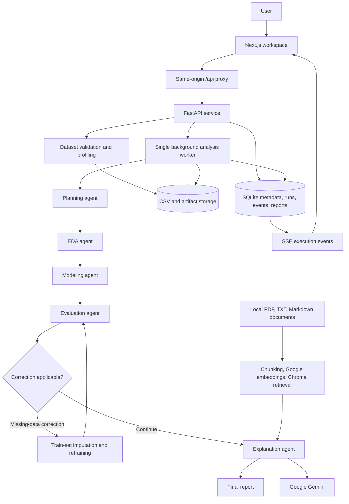

# AURA-DS

**Autonomous Unified Reasoning & Analytics Data Science Agent**

AURA-DS brings dataset exploration, classification experiments, agent execution monitoring, model evaluation, and analytical reporting into one workspace. A Next.js interface connects to a FastAPI service that runs the existing Python agents and stores results for later review.

## The problem

A typical data science workflow involves profiling a dataset, choosing a target, preparing features, training several models, comparing metrics, interpreting results, and preparing a report. Repeating these steps across notebooks and scripts takes time and makes it harder to track how a result was produced.

AURA-DS coordinates those steps through specialized agents. Users can configure an experiment, follow its execution, inspect measured results, and reopen the report and artifacts later.

## What makes AURA-DS different?

| Design choice | How it helps |
|---|---|
| A connected analytical workflow | Dataset inspection, training, evaluation, and reporting share the same analysis context. |
| Observable agent execution | Server-Sent Events expose recorded stage transitions and timestamps as the backend executes. |
| Multiple classifier candidates | Logistic Regression, Random Forest, and Gradient Boosting can be benchmarked on the same train/test split. |
| Explicit model selection | The engine selects the highest weighted F1 score, using accuracy as the tie-breaker. |
| A separate system verdict | Evaluation combines data quality and model quality using an inspectable scoring rule. |
| Targeted self-correction | Missing-feature failures can trigger retraining with imputation fitted on the training data. |
| Knowledge-grounded explanations | The explanation agent retrieves local reference material and uses Gemini to interpret the analytical outputs. Retrieved source information is available when generation succeeds. |
| Persistent execution records | SQLite stores run configuration, metrics, events, and reports so a completed analysis can be reopened. |

These are the project's implementation choices. Comparative performance against other analytics products has not been benchmarked.

## Capabilities

- CSV upload with validation, progress, cancellation, and a 20 MB size limit.
- Dataset schema, paginated preview, search, sorting, and column visibility.
- Profiling of missing values, duplicate rows, numeric statistics, categorical counts, distributions, and correlations.
- Classification configuration with target selection, model selection, test split, and random state.
- Background analysis execution with a workflow diagram, stage details, live events, and an execution timeline.
- Model comparison with accuracy, weighted precision, weighted recall, weighted F1, and training duration.
- Evaluation scores, PASS/FAIL verdicts, detected issues, and recommendations.
- Analytical reports with copy, print, and Markdown download actions.
- Downloads of the winning model and target-distribution plot.
- Searchable run history, report reopening, and deletion of finished runs.
- Light and dark themes, responsive layouts, and service-status checks.

## Architecture



The API accepts an analysis configuration, persists a queued run, and submits it to one background worker. Agent transitions are recorded in SQLite and delivered to the interface through SSE. Each workspace run has its own artifact directory.

The explanation stage loads reference documents from `knowledge/documents/`, builds the retrieval store through the existing knowledge layer, and calls Gemini. If explanation generation fails, the workspace records it as unavailable and still produces a report containing the measured analytical results.

### Execution entry points

| Entry point | Behavior |
|---|---|
| Web workspace and `backend/api.py` | Configurable classification runs, persistence, live events, missing-data correction, and report generation. |
| `main.py` | Original direct Python pipeline using `data/adult.csv`. It stops when evaluation fails. |
| `orchestration/analysis_graph.py` | Separate LangGraph workflow with conditional routing and a correction flag passed to modeling. |

The workspace uses its API worker to coordinate the agents. The CLI and LangGraph entry points retain their own execution behavior.

### Evaluation rule

```text
System score = 0.4 × Data quality score + 0.6 × Model quality score
PASS when system score >= 0.70
```

For the current classification engine, model quality is based on accuracy. Data quality starts at 1.0 and receives penalties for missing values and severe target imbalance. Model selection uses weighted F1 first, so selection and evaluation use different criteria.

A PASS indicates that this scoring rule was satisfied. Assess suitability using the dataset, class balance, held-out metrics, and intended application.

## Technology stack

| Layer | Technologies |
|---|---|
| Interface | Next.js App Router, React, TypeScript, CSS design tokens, Lucide |
| Visualizations | Recharts, React Flow, Matplotlib |
| API and validation | FastAPI, Pydantic, Uvicorn |
| Data and ML | pandas, NumPy, scikit-learn, joblib |
| Agent and knowledge layer | LangGraph, LangChain, Gemini, Google embeddings, Chroma |
| Persistence | SQLite and local files |
| Verification | Python unittest, FastAPI TestClient, Playwright with Microsoft Edge |
| Packaging | Dockerfiles and Docker Compose |

## Project structure

```text
.
├── frontend/
│   ├── src/app/                 Application entry points and styles
│   ├── src/components/          Workspace views and typed API client
│   ├── tests/workspace.mjs      Browser workflow test
│   └── Dockerfile
├── backend/
│   ├── api.py                  API, persistence, worker, and SSE
│   └── Dockerfile
├── agents/                     Planning, EDA, modeling, evaluation, explanation
├── core/                       Original shared analysis state
├── orchestration/              Separate LangGraph workflow
├── knowledge/
│   ├── documents/              Reference documents for retrieval
│   ├── document_loader.py
│   ├── embedder.py
│   └── retriever.py
├── data/                       Original input datasets
├── artifacts/                  Original CLI artifacts
├── output/workspace/           Local workspace database, CSVs, reports, artifacts
├── scripts/start-workspace.ps1 Windows launcher implementation
├── tests/test_pipeline.py      API integration tests
├── Start-AURA.cmd              Windows workspace launcher
├── main.py                     Original CLI pipeline
├── requirements.txt
├── compose.yaml
└── README.md
```

## Installation

Use Python 3.12 and Node.js 24. Run the following commands from this repository's root folder.

### 1. Install dependencies

A virtual environment keeps Python dependencies together. Calling its interpreter directly also avoids requiring PowerShell activation.

```powershell
python -m venv .venv
.\.venv\Scripts\python.exe -m pip install -r requirements.txt httpx
npm.cmd --prefix frontend ci
```

### 2. Configure the explanation service

Create or update `.env` in the project root. Supply your own Google API key.

```dotenv
GOOGLE_API_KEY=your_google_api_key
AURA_GEMINI_MODEL=gemini-2.5-flash
```

The workspace can train and evaluate models without this key. Gemini explanations and Google embedding requests require working credentials and network access. Keep `.env` private and excluded from version control.

Place relevant PDF, UTF-8 TXT, or Markdown reference documents in `knowledge/documents/` for retrieval.

### 3. Start the API

In the first terminal, from the project root, run:

```powershell
.\.venv\Scripts\python.exe -m uvicorn backend.api:app --host 127.0.0.1 --port 8000
```

### 4. Start the frontend

In a second terminal, from the same project root, run:

```powershell
npm.cmd --prefix frontend run dev
```

Keep both terminals open, wait for Next.js to report that it is ready, and open [AURA-DS](http://127.0.0.1:3000/).

### Windows and VS Code launcher

After installing dependencies, run this command from the project root in the VS Code terminal:

```powershell
.\Start-AURA.cmd
```

Alternatively, choose **Terminal > Run Task > AURA-DS: Run workspace** in VS Code.

The launcher prefers `.venv/Scripts/python.exe`, checks Python dependencies, starts the API and Next.js development server, and waits for the page and proxied API to respond. Open the URL after the terminal prints **AURA-DS is ready**.

Keep this terminal open while using the project. Press Ctrl+C to stop both services. Startup and service failures appear in the terminal, with logs under `output/workspace/`. Opening the browser URL requires the servers to be running.

For a production build, run the following commands separately after stopping development mode:

```powershell
npm.cmd --prefix frontend run build
npm.cmd --prefix frontend run start
```

Start the backend separately as described above when using production mode.

## How to use the project

1. Open **Dataset Registry**, select **Choose CSV**, and upload a dataset.
2. Inspect its **Overview**, **Data preview**, **Schema**, **Profiling**, and **Data quality** tabs.
3. Select **Analyze dataset** and choose the target column.
4. Select one or more classifiers, set the test split between 10% and 50%, and choose a random state.
5. Select **Run analysis**. The workspace opens the new execution.
6. Follow stage transitions in **Agent Runs** and inspect the execution timeline.
7. Open **EDA Explorer** to inspect feature statistics, distributions, missing values, and correlations.
8. Open **Model Benchmarking** to compare candidate metrics, training times, and the selected model.
9. Open **Model Evaluation** to review the system score, verdict, and recommendations.
10. Open **AI Insights** to read the report and inspect retrieved knowledge when available.
11. Use **Reports** to download the report or artifacts.
12. Return to **Analysis History** to search and reopen a saved run.

### Dataset requirements

- Upload a readable UTF-8 CSV up to 20 MB.
- Include at least two columns and at least one data row.
- Choose a classification target containing 2–50 distinct classes and no missing target values.
- Each class needs at least two records. Both training and test partitions must have enough rows to contain all classes.
- Resolve unsuitable feature types or values if training reports an error. The correction path handles supported missing-feature cases through training-set imputation.

## Configuration

| Variable | Purpose | Default |
|---|---|---|
| `GOOGLE_API_KEY` | Gemini and embedding credentials | Unconfigured |
| `AURA_GEMINI_MODEL` | Workspace explanation model | `gemini-2.5-flash` |
| `AURA_STORAGE` | Backend storage directory | `output/workspace` |
| `AURA_API_URL` | Next.js backend destination | `http://127.0.0.1:8000` |

For a production frontend build, set `AURA_API_URL` before building. The browser calls the frontend's same-origin API proxy.

## Persistence and artifacts

The local workspace stores its SQLite database at `output/workspace/workspace.sqlite3`. Uploaded CSVs are assigned generated identifiers. Each run stores its generated files in a directory named after its run ID.

Run history includes configuration, events, model metrics, evaluation results, and report text. The API exposes downloads through validated identifiers and an artifact allowlist.

Back up the complete workspace storage directory while the API is stopped to retain both the database and its associated files. Docker Compose stores workspace data in the named `workspace` volume.

## API overview

| Method | Route | Purpose |
|---|---|---|
| POST | `/api/datasets/upload` | Upload a CSV body with an `X-Filename` header |
| GET | `/api/datasets` | List registered datasets |
| GET | `/api/datasets/{id}` | Inspect dataset metadata and schema |
| GET | `/api/datasets/{id}/profile` | Retrieve profiling statistics |
| GET | `/api/datasets/{id}/preview` | Search, sort, and paginate preview rows |
| POST | `/api/analyses` | Queue a classification run |
| GET | `/api/analyses` | List run summaries |
| GET | `/api/analyses/{id}` | Retrieve a run, configuration, results, and report |
| GET | `/api/analyses/{id}/events` | Stream execution events using SSE |
| GET | `/api/analyses/{id}/results` | Retrieve structured results |
| GET | `/api/analyses/{id}/report` | Download the Markdown report |
| GET | `/api/analyses/{id}/artifacts` | List available artifacts |
| GET | `/api/analyses/{id}/artifacts/{name}` | Download an allowed artifact |
| DELETE | `/api/analyses/{id}` | Delete a finished run and its artifacts |
| GET | `/api/health` | Inspect backend service status |

With the API running, browse the [interactive API documentation](http://127.0.0.1:8000/docs).

## Docker

From the repository root, run:

```powershell
docker compose up --build
```

Compose starts the API and web service, publishes [the workspace](http://127.0.0.1:3000/) on loopback, and persists state in a named volume. It reads the Google key and model variables through the Compose environment configuration.

The Compose configuration has been validated. A complete container build and runtime verification remain pending.

## Verification

Run the backend tests:

```powershell
.\.venv\Scripts\python.exe -m unittest discover -s tests -v
```

Build the frontend with TypeScript checking:

```powershell
npm.cmd --prefix frontend run build
```

Run the browser workflow with Microsoft Edge installed:

```powershell
node frontend/tests/workspace.mjs
```

The browser test starts temporary services on ports 3031 and 8031, uses temporary storage, and disables Gemini. Run it with Python dependencies available on PATH. For the project environment, prepend its Scripts directory using $env:Path = (Join-Path (Get-Location) '.venv/Scripts') + ';' + $env:Path before running the browser test.

Previous workspace verification covered two API integration tests, a production frontend build, and a browser workflow from upload through reporting and history reopening. Responsive Overview checks covered widths of 1440, 1280, 1024, 768, and 375 pixels. Live Gemini generation and retrieval were not verified in those tests.

## Troubleshooting

| Symptom | What to check |
|---|---|
| `ERR_CONNECTION_REFUSED` at port 3000 | Start the frontend and wait for Ready. Keep its terminal or launcher window open. |
| Interface opens but API requests fail | Start the API on port 8000 and inspect its terminal output or `output/workspace/api.stderr.log` when using the launcher. |
| Launcher reports missing Python modules | Install requirements into `.venv`. The launcher prefers its Python interpreter and otherwise uses PATH. |
| Launcher reports a busy port | Check the existing server window. Reuse it or close that server before starting another instance. |
| UI still shows an older version | The launcher uses development mode. For a separately started production server, stop it and rebuild before restarting. |
| Report says explanation unavailable | Check Google credentials, network connectivity, the configured model, reference documents, and backend logs. |
| Analysis validation rejects a target | Check class count, missing target values, samples per class, and the selected split. |
| A run is failed after an API restart | Interrupted queued or running jobs are marked failed. Start a new analysis. |
| Build fails while development mode is active | Stop the development server and rerun the build. |

## Current boundaries and next steps

The current workspace supports CSV classification and uses one background worker per API process. Run one API process per storage directory. Queued or running jobs are marked failed after a worker restart.

Authentication, workspace access controls, regression training, Excel upload, cross-validation, hyperparameter search, and distributed job execution remain future work. Keep the local deployment bound to loopback.

The health page reports configured or checked status for each service. Gemini connectivity and the knowledge store are checked during explanation execution.

Useful next steps include authenticated workspaces, a durable external job queue, PostgreSQL storage, broader model diagnostics, and regression workflows backed by tests.

## Author

**Nooh Khan**

[GitHub profile](https://github.com/noohkhan7232)
